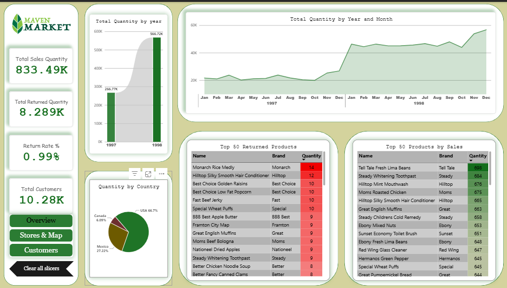
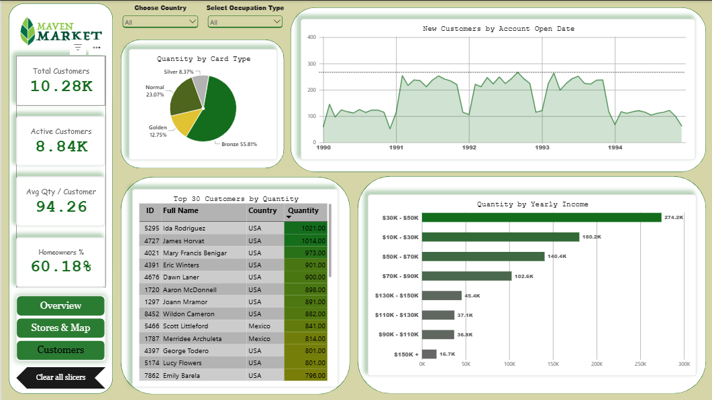
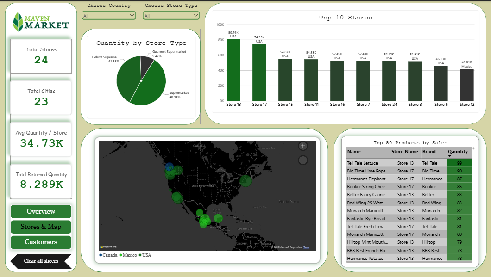

# 🛒 Maven Market — End-to-End Retail Analytics


## 📌 Project Overview

Maven Market is a fictional international grocery retailer operating across the **United States, Mexico, and Canada**.

This project delivers an end-to-end retail analytics and business intelligence solution, transforming raw business data into a structured SQL Server data warehouse and interactive Power BI dashboards.

The project covers the complete data analytics workflow, including:

- Business Understanding and Data Exploration.
- Data Cleaning and Transformation using Python.
- Data Warehousing and ETL using Microsoft SQL Server.
- Fact Constellation Schema Design.
- Business Analysis using T-SQL.
- Data Modeling and DAX Measures.
- Interactive 3-page Power BI Dashboard.

---

## 🛠️ Tools & Technologies

| Tool                 | Purpose                                   |
| -------------------- | ----------------------------------------- |
| Python               | Data exploration and cleaning             |
| Pandas & NumPy       | Data manipulation and transformation      |
| Matplotlib & Seaborn | Exploratory Data Analysis                 |
| Microsoft SQL Server | Database development and data warehousing |
| T-SQL                | Data transformation and business analysis |
| Power BI             | Data modeling and interactive dashboards  |
| DAX                  | Measures and analytical calculations      |
| Git & GitHub         | Version control and documentation         |

---

## 📂 Repository Structure

```text
Maven_Market_End_to_End/
│
├── Assets/
│   ├── Maven_Market.png
│   └── Screenshots/
│       ├── Overview.png
│       ├── Customers.png
│       └── Stores_Map.png
│
├── Data/
│   ├── Raw Data/
│   └── Processed/
│
├── Documentation/
│   ├── Business_Understanding.md
│   └── 02_Data_Cleaning_Documentation.md
│
├── Notebooks/
│   ├── 01_Data_Exploration.ipynb
│   └── 02_Data_Cleaning.ipynb
│
├── PowerBI/
│   └── Maven_Market_Reports.pbix
│
├── SQL/
│   ├── DB Diagram/
│   ├── 01_Database_Setup_and_Staging.sql
│   ├── 02_Dimensions_Loading.sql
│   ├── 03_Fact_Tables_Loading.sql
│   └── 04_SQL_Analysis.sql
│
└── README.md
```

---

## 🔄 Project Workflow

### 1. Business Understanding

Defined the business objectives, project scope, stakeholders, and key performance indicators.

Identified the main business questions related to:

- Sales performance.
- Product performance.
- Store performance.
- Customer demographics and purchasing behavior.
- Product returns.

### 2. Data Exploration & Cleaning — Python

Used Python and Pandas to explore and prepare the original CSV datasets.

Key activities:

- Inspected dataset structures, dimensions, and data types.
- Analyzed missing values and duplicate records.
- Investigated potential data quality issues.
- Combined the 1997 and 1998 transaction datasets.
- Converted date columns into proper datetime formats.
- Standardized identifier columns.
- Exported cleaned datasets for SQL Server ingestion.

### 3. Data Warehousing & ETL — SQL Server

Designed and implemented a data warehouse using Microsoft SQL Server.

Key activities:

- Created a staging schema (`stg`) for raw data ingestion.
- Imported CSV datasets using `BULK INSERT`.
- Created and populated dimension and fact tables.
- Applied data type conversions and data validation.
- Implemented Primary Keys and Foreign Keys.
- Integrated Regions data into the Store dimension.

### 4. Data Modeling

Designed a **Fact Constellation Schema** consisting of two fact tables sharing common dimensions.

**Dimension Tables:**

- `DimCustomer`
- `DimProduct`
- `DimStore`
- `DimDate`

**Fact Tables:**

- `FactTransactions`
- `FactReturns`

The model supports analyzing sales and returns across products, stores, dates, and customers where the available data permits.

### 5. SQL Business Analysis

Used T-SQL to answer business questions and validate key metrics.

Analysis includes:

- Total sales quantity by year.
- Top-selling products.
- Top-performing brands.
- Store sales performance.
- Sales distribution by country.
- Most returned products.
- Returned quantity by country.
- Quantity-based return rate by country.

### 6. Power BI & DAX

Connected Power BI Desktop to the SQL Server data warehouse and developed the analytical data model.

Implemented DAX measures covering:

### Sales & Returns

- `Total Sales Quantity`
- `Total Returned Quantity`
- `Return Rate %`
- `Sales Quantity PY`
- `Sales Growth YoY %`
- `Sales Quantity PM`
- `Sales Growth MoM %`
- `Country Sales %`

### Products & Stores

- `Total Products`
- `Total Stores`
- `Product Rank`
- `Store Rank`
- `Total Cities`
- `Avg Quantity / Store`

### Customer Analytics

- `Total Customers`
- `Active Customers`
- `Avg Qty / Customer`
- `Homeowners %`

### 7. Interactive Power BI Dashboard

Developed a **3-page interactive Power BI report** with a consistent visual design, navigation sidebar, interactive slicers, and KPI cards.

#### Page 1 — Executive Overview

Provides a high-level view of overall retail performance.

Key visuals:

- Total Sales Quantity.
- Total Returned Quantity.
- Return Rate.
- Total Customers.
- Yearly Sales Quantity.
- Monthly Sales Trend.
- Sales Quantity by Country.
- Top 50 Products by Sales.
- Top 50 Returned Products.



#### Page 2 — Customer Analytics

Explores customer demographics, loyalty, and purchasing behavior.

Key visuals:

- Total Customers.
- Active Customers.
- Average Quantity per Customer.
- Homeowners Percentage.
- Quantity by Card Type.
- New Customers by Account Open Date.
- Top 30 Customers by Quantity.
- Quantity by Yearly Income.



#### Page 3 — Stores & Map

Evaluates store performance and geographical distribution.

The page provides insights into:

- Store performance.
- Store locations across countries and cities.
- Sales distribution across store types.
- Geographical performance comparison.



**Dashboard Features:**

- Interactive slicers for Country, Store Type, and Occupation.
- Navigation buttons between report pages.
- Clear All Slicers functionality using Bookmarks.
- KPI cards and conditional formatting.
- Consistent dashboard layout and visual theme.

---

## 💡 Key Business Insights

### 1. Sales Growth

- Total sales quantity increased from **266,773 units in 1997** to **566,716 units in 1998**.
- This represents approximately **112.45% year-over-year growth**.

### 2. Top-Performing Products

- Tell Tale Fresh Lima Beans ranked first with 698 units sold.
- The top 10 products had relatively close sales volumes, ranging from 648 to 698 units.

### 3. Brand Performance

The top-performing brands by sales quantity were:

1. Hermanos — 24,682 units.
2. Tell Tale — 23,801 units.
3. Ebony — 23,492 units.
4. Tri-State — 23,400 units.
5. High Top — 22,040 units.

### 4. Store Performance

- Store 13 ranked first with **80,762 units sold**.
- Store 17 ranked second with **74,347 units sold**.
- Both stores significantly outperformed the other branches.

### 5. Sales by Country

| Country | Sales Quantity | Share of Total Sales |
| ------- | -------------: | -------------------: |
| USA     |        555,899 |               66.69% |
| Mexico  |        226,838 |               27.22% |
| Canada  |         50,752 |                6.09% |

The United States accounts for approximately two-thirds of total sales quantity.

### 6. Product Returns

- Total returned quantity: **8,289 units**.
- The USA recorded the highest returned quantity, with 5,431 units.
- Hermanos Red Pepper was the most returned product, with 17 units.

### 7. Return Rate by Country

Return Rate is calculated using:

`Return Rate = Total Returned Quantity / Total Sales Quantity × 100`

| Country | Return Rate |
| ------- | ----------: |
| Canada  |       1.07% |
| Mexico  |       1.02% |
| USA     |       0.98% |

Although the USA has the highest returned quantity, Canada has the highest quantity-based return rate.

---

## ⚠️ Data Limitations

Some limitations in the original datasets affect the scope of the analysis:

- The Transactions dataset does not contain a transaction or order ID.
- Sales Amount and Profit are not directly available.
- Sales performance is therefore measured using **Quantity Sold**, not Revenue.
- The Returns dataset does not contain a customer ID.
- Return Rate represents returned quantity relative to sold quantity, not the percentage of orders or customers that returned products.
- Potential duplicate records were investigated and retained when there was insufficient evidence to classify them as invalid.

These limitations were considered when defining the KPIs and interpreting the results.

---

## 🚀 How to Run This Project

### 1. Clone the Repository

```bash
git clone https://github.com/AhmedS-Data/Maven_Market_End_to_End.git
```

### 2. Explore the Python Notebooks

Open the notebooks using Jupyter Notebook or VS Code:

- `01_Data_Exploration.ipynb`
- `02_Data_Cleaning.ipynb`

Make sure the original CSV datasets are available inside `Data/Raw Data/`.

### 3. Build the SQL Server Database

Open the SQL scripts in SQL Server Management Studio (SSMS).

Execute them in the following order:

1. `01_Database_Setup_and_Staging.sql`
2. `02_Dimensions_Loading.sql`
3. `03_Fact_Tables_Loading.sql`
4. `04_SQL_Analysis.sql`

**Important:** Update the CSV file paths inside the `BULK INSERT` statements to match your local directory.

### 4. Open the Power BI Report

Open:

`PowerBI/Maven_Market_Reports.pbix`

in Power BI Desktop.

Make sure the SQL Server connection points to your local database instance.

---

## 🎯 Project Objective

The objective of this project is to demonstrate a complete data analytics workflow, from raw data exploration and preparation to data warehousing, SQL-based analysis, and interactive business intelligence reporting.
